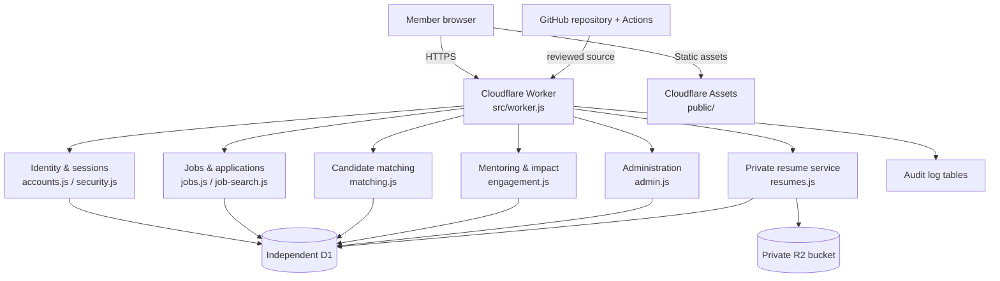

# UdyogMitra — application architecture

## Scope and trust boundary
UdyogMitra is a closed, approval-based community employment and referral portal. It is an independent application: its users, sessions, D1 database and R2 resume bucket must never be shared with SST Seva. Current job discovery searches only vacancies posted into UdyogMitra by its members. External job feeds and APIs are explicitly out of scope for this release.

## Logical architecture

## Request flow
1. Browser loads static assets from the Worker assets binding.
2. API requests use the same origin and an HttpOnly, Secure, SameSite=Lax session cookie.
3. Worker hashes the session token and resolves the approved member from D1.
4. Each route checks feature permissions and resource ownership on the server. Hiding a menu item is not an authorization control.
5. Jobs are searched and ranked only from open, non-expired community postings. Search quota is 50 keyword searches per member per UTC day.
6. Candidate matches are indicative, explainable keyword/skill, location and experience scores; they are not guarantees of eligibility.
7. Resume objects are private R2 objects. Access is restricted to the candidate owner or the poster of a job to which that candidate has applied.

## Domain modules
| Module | Responsibility |
|---|---|
| `src/worker.js` | HTTP routing, session gate, registration, approval, common error boundary |
| `src/security.js` | PBKDF2 password hashing, session resolution, feature authorization |
| `src/accounts.js` | account activation and private account lifecycle |
| `src/admin.js` | role assignment, bulk import, suspension |
| `src/jobs.js` | job search/post/close, candidate records, applications |
| `src/job-search.js` | weighted keyword ranking, related terms and filters |
| `src/matching.js` | candidate-to-job relevance scoring |
| `src/application-workflow.js` | allowed application status transitions |
| `src/engagement.js` | opt-in discovery, mentors, guidance and impact |
| `src/resumes.js` | private R2 resume upload/download |

## Reusable foundation patterns
The supplied `varadatechworks/app-skeleton` was reviewed. UdyogMitra adopts its small, explicit state-machine approach for application lifecycle and its deny-by-default authorization and security review principles. The skeleton is a reference library, not a drop-in framework; Node-specific adapters are not imported into the Cloudflare Worker. Confirm repository ownership/licensing before redistributing skeleton-derived material outside the organization.

## Deployment topology
See [deployment diagram and runbook](deployment-runbook.md). Cloudflare Worker, D1 and R2 are separate resources from SST Seva. GitHub Actions validates source and migrations; CI success is not proof of browser/UAT or production readiness.
