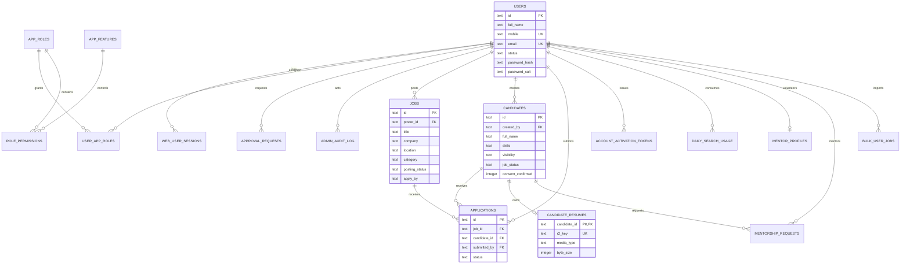

# UdyogMitra — database schema and migration reference

Database: Cloudflare D1 (SQLite dialect). Database name: `udyog-mitra-db`. The database ID in `wrangler.jsonc` is intentionally a placeholder until a new independent D1 database is created. Never point this application to SST Seva D1.

## Entity relationship diagram

## Tables
| Table | Purpose | Main relationship / controls |
|---|---|---|
| users | Member identities and approval state | Unique mobile/email; approved status required for login |
| app_roles | Member, approver, administrator | Seeded by migration 0001 |
| app_features | Feature permission catalogue | Seeded by migration 0001 |
| role_permissions | CRUD grants per role and feature | Composite primary key |
| user_app_roles | Active role assignment | Composite primary key |
| web_user_sessions | Hashed session tokens and expiry | Session token is not stored in plaintext |
| approval_requests | Membership review queue | Requested user and reviewer |
| admin_audit_log | Administrative actions | Actor, action, target, details, timestamp |
| bulk_user_jobs | Bulk import job metadata | Actor and summary |
| jobs | Member-posted openings | Poster, category, location, status, apply-by |
| candidates | Candidate profiles | Creator, consent, visibility and job-seeking state |
| applications | Candidate referrals and lifecycle | Unique job/candidate pair; status check |
| account_activation_tokens | One-time activation | Token hash, expiry and used timestamp |
| candidate_resumes | Resume metadata | Private R2 object key, type and size |
| login_throttle | Failed-login throttle | Identifier, failures and lock expiry |
| mentorship_requests | Career guidance requests | Candidate, requester, mentor and status |
| mentor_profiles | Member mentor opt-in | User, areas, bio and active flag |
| daily_search_usage | Keyword search quota | User/day composite key; count 0–50 |

## Migration inventory
| File | Changes |
|---|---|
| 0001_identity.sql | Users, roles, features, permissions, sessions, approvals, audit and bulk-job tables |
| 0002_jobs.sql | Jobs, candidate profiles and applications |
| 0003_activation.sql | One-time activation tokens |
| 0004_resumes.sql | Resume metadata |
| 0005_login_throttle.sql | Login attempt throttle |
| 0006_employment_support.sql | Candidate visibility/status, desired roles, job category, mentoring |
| 0007_daily_search_quota.sql | Per-member UTC-day search counter |

## Migration policy
- Apply migrations in numeric order using Wrangler's D1 migration system. Do not run edited historical migrations against an existing database.
- Back up D1 before remote migration. Apply first to local/isolated staging D1, then remote staging.
- Schema changes must be additive where possible. For destructive changes, use expand → migrate data → verify → contract in a later release.
- Do not manually delete `d1_migrations` records to force reapplication.
- Foreign-key checks are enabled in the schema validation script. Keep them enabled in test fixtures.
- R2 objects are not included in D1 exports. Back up/retain R2 objects separately and reconcile metadata with object keys.
