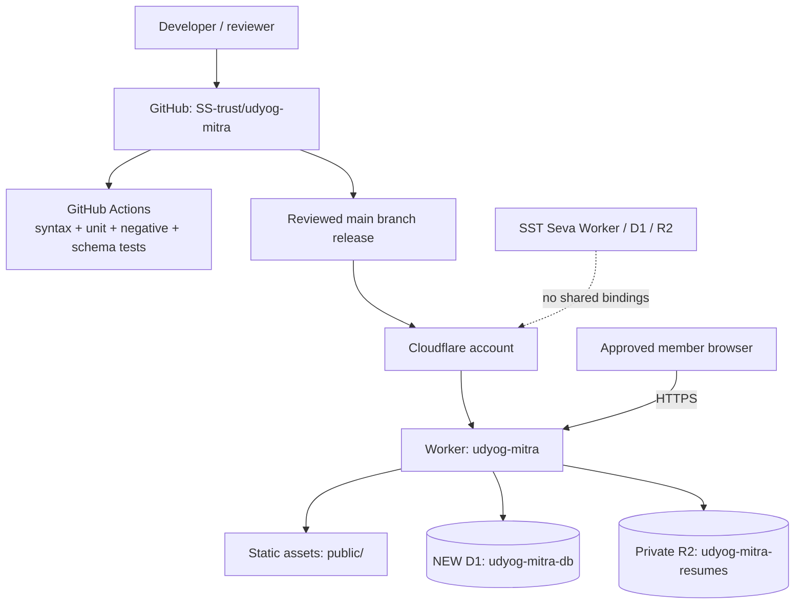

# UdyogMitra — deployment and operations runbook

## Topology


## Preconditions
- Use the same Cloudflare account if desired, but create a **new Worker**, a **new D1 database**, and a **new private R2 bucket**.
- Do not reuse SST Seva's database, bucket, authentication cookie or Worker.
- Keep R2 public access disabled.
- Configure a separate hostname (for example, a chosen UdyogMitra subdomain) only after DNS and domain ownership are confirmed.
- Do not commit API tokens, D1 credentials, passwords, activation tokens or real resumes.

## One-time resource provisioning
Run from a trusted workstation with Node.js 22+ and Wrangler 4 installed and authenticated:
```powershell
npm install
npx wrangler d1 create udyog-mitra-db
npx wrangler r2 bucket create udyog-mitra-resumes
```
Copy the newly created D1 database ID into `wrangler.jsonc` replacing `REPLACE_WITH_NEW_UDYOG_MITRA_D1_ID`. Do not paste Cloudflare API tokens into GitHub or chat. Verify the R2 bucket has no public domain enabled.

## Local validation
```powershell
npm test
python tests/schema_integrity.py
npx wrangler d1 migrations apply udyog-mitra-db --local
npx wrangler dev
```
Use synthetic members, jobs and candidate profiles only. Do not import real candidate data into development.

## Staging deployment sequence
1. Confirm latest GitHub Actions checks are green.
2. Back up staging D1 and record current migration list.
3. Apply migrations: `npx wrangler d1 migrations apply udyog-mitra-db --remote`.
4. Deploy Worker: `npx wrangler deploy`.
5. Configure the staging hostname and TLS.
6. Run the full UAT checklist in [uat-and-negative-tests.md](uat-and-negative-tests.md).
7. Test resume upload/download with synthetic documents, authorization boundaries and session revocation.
8. Review logs, errors, resource consumption and Cloudflare limits for at least one complete UAT cycle.

## First administrator
Follow the controlled first-admin procedure in README. Set `FIRST_ADMIN_SETUP_KEY` as a Worker secret, call the setup endpoint only over HTTPS from a trusted environment, then immediately delete the secret. Verify the first admin can sign in and create an approver. Never store the setup key in source control or build logs.

## Safe migration script
Use `scripts/migrate-d1.ps1`. It defaults to local. Remote mode requires an explicit confirmation phrase. Always take a backup first.

## Rollback
- Worker rollback: use Cloudflare Workers deployment history to roll back to the last known-good Worker version.
- D1 rollback: do not assume Worker rollback reverses schema changes. Restore a verified pre-migration export to a new/isolated database, validate it, then switch the Worker binding deliberately.
- R2 rollback: restore objects from the separately managed backup. D1 export does not include R2 files.
- Record incident time, release SHA, migration number, impact and recovery steps.

## Production go/no-go
Production requires signed-off UAT, security review, resume malware scanning or a documented safe alternative, retention/consent policy, backup/restore drill, rate-limit review, PBKDF2 CPU benchmark, monitoring and explicit business approval. This repository has not been deployed by this documentation change.
